

**English** · [Русский](README.ru.md)

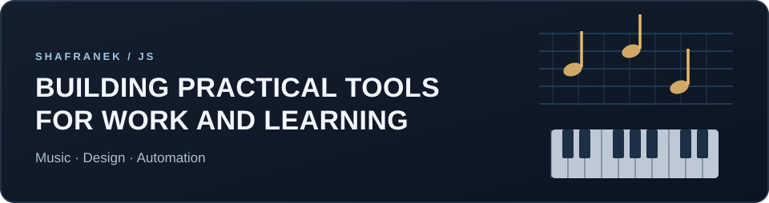

**Music education · Creative tooling · Applied automation**

I build practical apps for learning, creative work and workflow automation — combining interactive interfaces, algorithms, document processing and audio technologies.

[All repositories](https://github.com/shafranek-js?tab=repositories) · [Explore NotaRe](https://shafranek-js.github.io/Nota-Re/) · [Try Learning Markdown](https://learning-markdown.pages.dev/)

### Featured applications

<a href="https://github.com/shafranek-js/Nota-Re">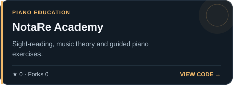</a> <a href="https://github.com/shafranek-js/play-along">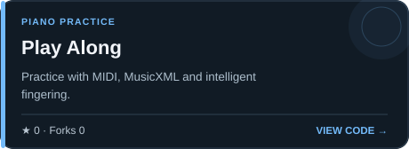</a>

<a href="https://github.com/shafranek-js/CartonBuilder">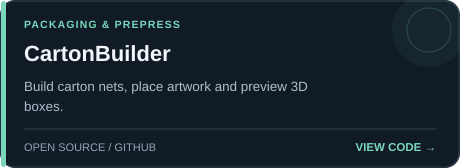</a> 

<a href="https://github.com/shafranek-js/pianomotion-studio">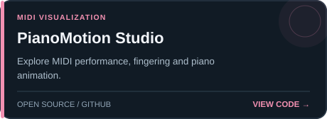</a> <a href="https://github.com/shafranek-js/cadenceflow">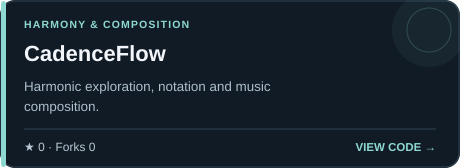</a>

**Live apps:** [NotaRe Academy](https://shafranek-js.github.io/Nota-Re/) · [Play Along](https://shafranek-js.github.io/play-along/) · [Learning Markdown](https://learning-markdown.pages.dev/) · [PianoMotion Studio](https://shafranek-js.github.io/pianomotion-studio/) · [CadenceFlow](https://shafranek-js.github.io/cadenceflow/) · [HarpTrainer](https://shafranek-js.github.io/HarpTrainer/)

### More music & learning

 <a href="https://github.com/shafranek-js/MelodicaTrainer">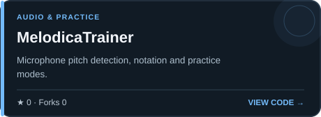</a>

<a href="https://github.com/shafranek-js/FretboardTrainer">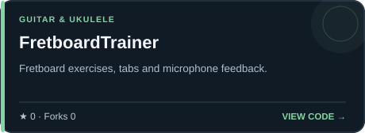</a> <a href="https://github.com/shafranek-js/HarpTrainer">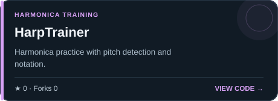</a>

### Tools & automation

<a href="https://github.com/shafranek-js/convert2md-ui">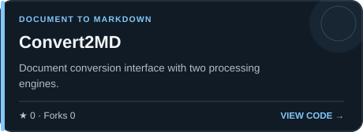</a> 

 <a href="https://github.com/shafranek-js/SonicBook">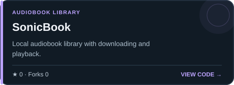</a>

---

Project cards and public GitHub metrics are generated from [transparent source code](scripts/) and refreshed daily via [GitHub Actions](.github/workflows/profile.yml). No invented downloads or user counts.
