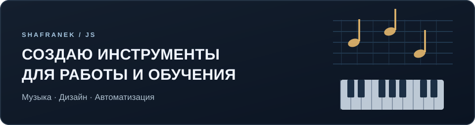
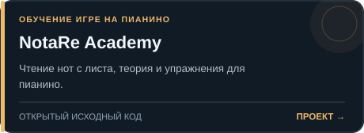
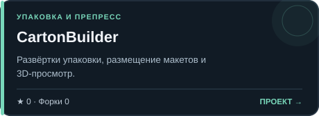
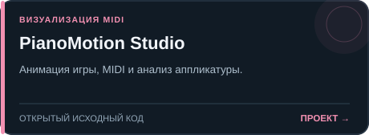
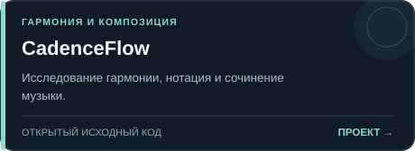
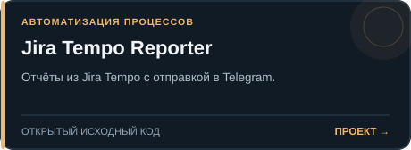

[English](README.md) · **Русский**

**Музыкальное образование · Инструменты для дизайна · Прикладная автоматизация**

Я создаю практичные приложения для обучения, творческих задач и автоматизации рабочих процессов. Мои проекты соединяют интерактивные интерфейсы, алгоритмы, обработку документов и работу со звуком.

[Все репозитории](https://github.com/shafranek-js?tab=repositories) · [Открыть NotaRe](https://shafranek-js.github.io/Nota-Re/) · [Попробовать Learning Markdown](https://learning-markdown.pages.dev/)

### Избранные приложения

 

 

 

**Работающие онлайн-приложения:** [NotaRe Academy](https://shafranek-js.github.io/Nota-Re/) · [Play Along](https://shafranek-js.github.io/play-along/) · [Learning Markdown](https://learning-markdown.pages.dev/) · [PianoMotion Studio](https://shafranek-js.github.io/pianomotion-studio/) · [CadenceFlow](https://shafranek-js.github.io/cadenceflow/) · [HarpTrainer](https://shafranek-js.github.io/HarpTrainer/)

### Музыка и обучение

 

 

### Инструменты и автоматизация

 

 

---

Карточки и показатели публичных репозиториев генерируются из [открытого исходного кода](scripts/) и ежедневно обновляются через [GitHub Actions](.github/workflows/profile.yml). Количество загрузок и пользователей не выдумывается.
